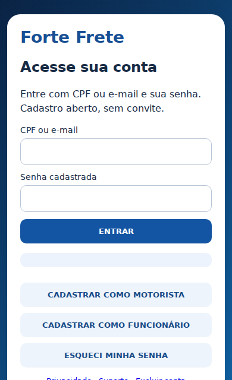
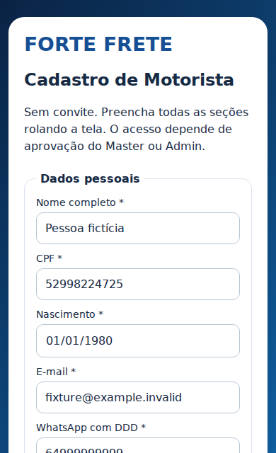
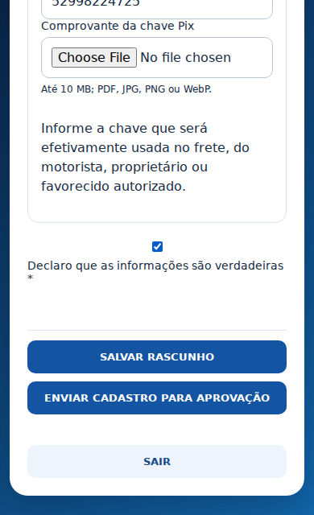
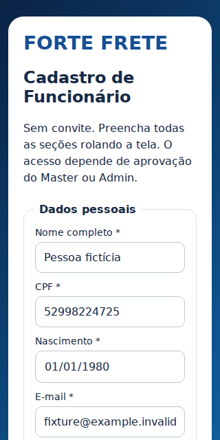
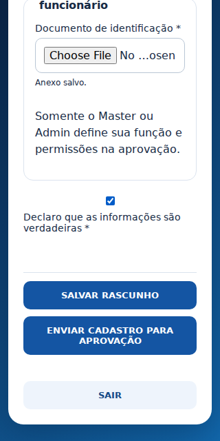

# Cadastro único mobile — Forte Frete

Implementação baseada no pacote `forte_frete_cadastro_mobile_work.zip`, inspecionado em 18/10/2026. Base de produção: `e7507500998515382d4f753da76e436362dbec4c`. Esta entrega está preparada para revisão; a migração e os novos endpoints ainda não foram publicados.

## Comportamento

| Entrada | Preenchimento | Aprovação |
| --- | --- | --- |
| Cadastrar como Motorista | Uma tela com dados pessoais, endereço, CNH, veículo/componentes, fotos, proprietário e favorecido | Tipo motorista fixo; operação bloqueada até análise completa |
| Cadastrar como Funcionário | Uma tela com dados pessoais, endereço e identificação | Usuário não escolhe função; Master/Admin define na aprovação |

Login aceita CPF ou e-mail; a recuperação já existente foi preservada. Não existe seleção de função pelo candidato. Mantido o padrão de senha numérica com seis ou mais dígitos do sistema existente. E-mail passa a ser obrigatório para novos cadastros completos. Endereço e documento do funcionário são persistidos no dossiê privado.

O botão Salvar rascunho exige os dados básicos para criar o acesso, mas permite guardar as demais seções incompletas. O usuário permanece inativo e pendente. Ao entrar novamente, retoma os dados e anexos confirmados no servidor. O primeiro cadastro já persiste os campos preenchidos, inclusive se o login automático falhar; arquivos ainda não enviados precisam ser selecionados novamente. Senhas não integram o rascunho.

O envio final exige todos os documentos e campos pertinentes, com validação transacional no banco. Veículo usa capacidade em toneladas, mantendo o padrão atual. Componentes ausentes precisam ser marcados explicitamente. CPF/CNPJ do proprietário e favorecido continuam obrigatórios conforme o cadastro existente. Nome e WhatsApp do proprietário são obrigatórios; o telefone fica também no cadastro do veículo. Pix é obrigatório quando selecionado para pagamento; outra forma exige dados bancários. Favorecidos e Pix existentes não são sobrescritos nem duplicados.

Master/Admin pode conferir o dossiê e abrir anexos com links privados de cinco minutos. Solicitar correção exige motivo e reabre somente um cadastro pendente, preservando anexos e registrando auditoria. Aprovação de cadastro incompleto é bloqueada no banco, inclusive em atualização direta do perfil. Motorista não pode receber um perfil de funcionário; funcionário não pode ser aprovado como motorista sem seu dossiê correspondente.

## Validação executada

- 28 testes de serviço e PostgreSQL isolado (PGlite): autenticação, origem, acesso administrativo, proteção contra função/credenciais no rascunho, revisão de versão, arquivos de outra pessoa, arquivos ausentes/tipo/tamanho inválidos, obrigatoriedade, CNH vencida, correção, envio idempotente, Pix e outra forma, aprovação, bloqueio de clientes diretos e manutenção de usuários legados.
- Cinco fluxos em Chromium com viewport mobile: motorista, funcionário em 320 px, falha de upload com reaproveitamento do anexo anterior, falha de login sem cadastro duplicado e convite indisponível sem bloquear o cadastro.
- Retomada em nova montagem da sessão, confirmação de anexos e nenhuma rolagem horizontal nos fluxos acima.
- Revisão de anexos e aprovação administrativa com falha/repetição testadas em 390 e 1280 px.
- Aviso de aprovação testado em 390 e 1280 px; regressões de autenticação/frontend e build aprovadas.
- Somente dados fictícios e serviços simulados nos testes; nenhuma conta real criada, aprovação real ou mensagem enviada.

Os testes de navegador usam o código real com API simulada; os testes de banco executam as funções SQL reais em banco isolado. Não substituem validação ponta a ponta após implantação nem testes em aparelhos Android/iOS reais. Nenhum antivírus novo foi integrado; mantidas validação de MIME/tamanho, namespace próprio e armazenamento privado.

## Telas capturadas

## Implantação após aprovação

1. Conferir que o HEAD da produção ainda corresponde à base ou revisar eventuais conflitos. Preservar backup e definições atuais das funções substituídas.
2. Aplicar `supabase/migrations/20261018205947_cadastro_unico_mobile.sql`. Não altera registros antigos nem copia dados pessoais para novas tabelas; cria tabela privada, RPCs, proteção na aprovação e coluna opcional no veículo. Substitui as funções de início/envio/assertiva do dossiê para aceitar fotos e pagamento não Pix, preservando os demais requisitos.
3. Publicar `registration-dossier` e a versão atualizada de `access-standard` somente no projeto Frete `nkynfboqwfxhhxcsrawl`. Entrada `index.ts`; dependências externas com versão fixada. Usar `verify_jwt=false`: ambos validam o usuário com `auth.getUser()` para ações protegidas; REGISTER/LOGIN são ações públicas do access-standard. Não publicar esta cópia nos projetos Fiscal/Vendas.
4. Integrar o PR e acompanhar o deploy automático do frontend no Render até `live`, incluindo o novo módulo no build e cache do service worker.
5. Conferir arquivos públicos, cadastro fictício nos dois tipos, rascunho após logout/login, upload, correção e aprovação. Cadastro pendente não pode acessar cargas. Executar advisors após a migração e avaliar novos achados em comparação com a situação anterior.

## Rollback sem perda de dados

Se o frontend apresentar regressão, retornar o frontend ao commit de produção anterior. Conservar a tabela, os endpoints novos e o bloqueio de aprovação: excluir a tabela ou remover a proteção descartaria rascunhos ou permitiria aprovação incompleta. Cadastros antigos aprovados continuam com seu fluxo existente; novos cadastros completos podem aguardar a correção da interface, sem liberar a operação. Não restaurar uma versão de access-standard que permita criar contas novas fora do dossiê obrigatório. Dados e anexos não devem ser apagados no rollback. O retorno integral do banco depende de revisar os cadastros criados após implantação, especialmente pagamentos por outra forma; preferir corrigir e republicar a interface com os dados preservados.
